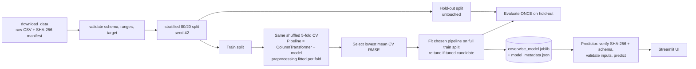

# Architecture

**Same preprocessing at inference.** The persisted object is the complete fitted `Pipeline`
(`preprocess` → `model`). The UI/`Predictor` passes a one-row DataFrame with the six raw columns; no encoding, scaling or
imputation is re-implemented outside the pipeline.

**Artifacts & versioning.** `model_metadata.json` stores model ID (first 12 hex chars of the artifact SHA-256), dataset
SHA-256, schema, protocol, metrics, library versions, timestamp and seed.

**Failure behaviour.** Missing/corrupt/tampered model, unreadable metadata or schema mismatch → `ModelUnavailableError`
(UI shows the message and disables prediction). Invalid inputs → `ValidationError` with per-field messages (model never
called). Non-finite model output → `PredictionError`. Missing dataset → `DatasetError` with the fix command.
